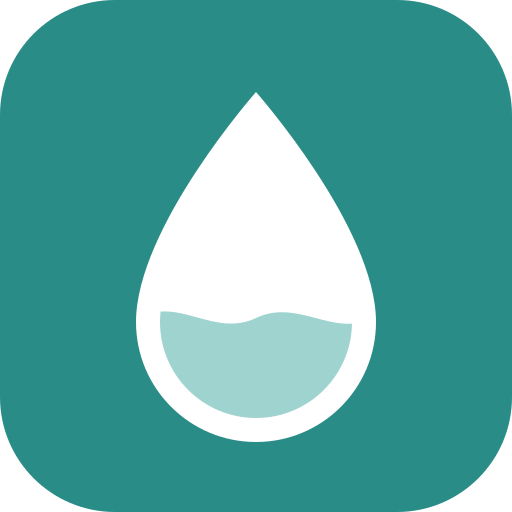
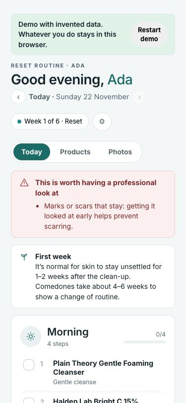
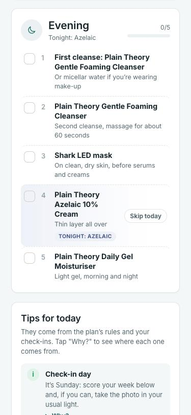
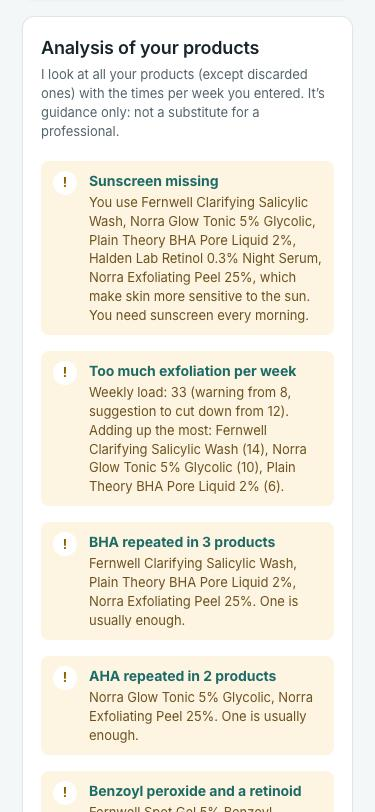
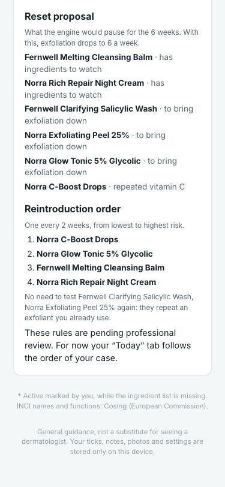

<p align="center"></p>

<h1 align="center">Truce</h1>
<p align="center"><b>Make peace with your skin.</b><br/>A skincare routine organiser that helps you find out what doesn't suit you, one product at a time.</p>

<p align="center"><a href="https://truce-demo.pages.dev"><b>Try the live demo →</b></a><br/><sub>Invented data · nothing leaves your browser · English and Spanish</sub></p>

<p align="center">
  
  
  
  
</p>

> **Not a diagnostic tool.** Truce organises a routine, flags ingredients worth watching and tells you when it's worth seeing a professional. It never diagnoses or promises results.

## The problem

Many people with breakouts keep adding products: a salicylic cleanser, an acid toner, retinol, two vitamin C serums… When the skin gets worse, there's no way to tell which product is to blame.

Truce applies the method a dermatologist would suggest:

1. **Reset.** Pause everything except a simple base routine for 6 weeks, so the skin calms down.
2. **Reintroduce one product at a time**, every 2 weeks, from the lowest to the highest risk.
3. **Track weekly** (scores, photos in the same light, a daily diary) and decide whether each product stays or goes.

## What it does

- **Builds the daily routine** (morning and evening) from the person's real products, including a weekly calendar for night treatments (azelaic acid, BHA, retinol) with safe spacing between them.
- **Reads ingredient lists** (INCI): pasted, scanned on the device with OCR, by barcode from Open Beauty Facts, or from a photo with an AI model, always confirmed line by line by the person.
- **Analyses the routine**: too much exfoliation per week, the same active in several products, acids or retinol without sunscreen, benzoyl peroxide with retinol, ingredients worth watching in rich creams.
- **Proposes the reset and the reintroduction order**, then runs each 2-week trial and asks at the end whether the product stays.
- **Safety first**: a short triage (deep painful bumps, scarring, pregnancy, prescription medication…) shows a "worth having a professional look at it" alert above everything else.
- **Daily tips, diary, photo comparison and a gentle points system** that rewards consistency, not buying more products.

## How it works

**A deterministic rule engine makes every decision. AI never does.**
`src/engine/` is pure TypeScript with no UI: the same products always give the same result. The engine returns rule ids (`R4`, `C2`, `T1`…) and data; the words live in translation files. AI is only used to transcribe a label photo, and the person confirms every ingredient.

**Every rule and every ingredient fact has a source and an evidence level.**
179 ingredients checked against the EU's CosIng database, each with its `source`. Rules are documented in [`docs/REGLAS.md`](docs/REGLAS.md) and marked as pending professional review. The app says so too.

**Language rules are part of the spec.** "An ingredient to watch", never "comedogenic, avoid it". "Worth having a professional look at it", never a diagnosis. Safety texts are fixed templates, never generated.

**Privacy first (local-first).** Skin photos, diary and check-ins are health data: they stay on the device (IndexedDB). Optional sync between devices is **end-to-end encrypted** (AES-GCM, key derived from a passphrase that never leaves the device); the server only ever stores ciphertext.

**Tested.** 300+ tests (Vitest), including an integration test per case: the invented demo case in [`docs/demo-case.md`](docs/demo-case.md) lists the engine's expected results and the test checks every one.

## Tech

| | |
|---|---|
| App | React + TypeScript + Vite, installable PWA (works offline) |
| Data | IndexedDB with Dexie, versioned migrations, JSON backup and restore |
| Engine | Pure TypeScript module, no dependencies, fully unit-tested |
| i18n | Spanish and English, typed dictionaries; a test checks both have the same keys and nothing is left untranslated |
| Label reading | Tesseract.js on the device; Claude (vision) behind a serverless function so the API key never reaches the browser |
| Products | Open Beauty Facts (open data, ODbL) |
| Sync | Cloudflare Pages Functions + D1, end-to-end encrypted |
| Hosting | Cloudflare Pages; the private app sits behind Cloudflare Access |

## Run it

```bash
npm install
npm run dev:demo   # the demo, with the invented case
npm test           # engine, data, sync and translation tests
npm run build:demo # production build of the demo in dist-demo/
```

## Project structure

```
src/engine/      rule engine (pure TypeScript) and its tests
src/i18n/        every text, Spanish (es.ts, the reference) and English (en.ts)
src/data/        ingredient database (CosIng) and the demo case
src/db/          local data (IndexedDB), backups and migrations
src/sync/        end-to-end encrypted sync
src/label/       label reading (OCR on the device, AI via the server)
src/components/  React views
functions/       Cloudflare Pages Functions (AI label reading, product lookup, sync)
docs/            spec, engine rules and the demo case (spec and rules are in Spanish)
```

## How it was built

Designed and directed by Andrea Martínez, coming from front-end development, and built with Claude Code as an AI pair programmer: product decisions, rules, wording and reviews by Andrea; code written by the AI under those rules (see [`CLAUDE.md`](CLAUDE.md)).

## Credits

- Ingredient names and functions: [CosIng](https://ec.europa.eu/growth/tools-databases/cosing/), European Commission.
- Product data: [Open Beauty Facts](https://world.openbeautyfacts.org), ODbL licence.
- The demo person, brands and products are invented. Ingredient names are real INCI names; any resemblance to a real product is accidental.

---

**En español:** Truce organiza tu rutina de skincare con tus productos reales y te ayuda a descubrir qué te sienta mal: un reset de 6 semanas y la reintroducción de los productos de uno en uno, con seguimiento semanal. Las decisiones las toma un motor de reglas determinista con fuentes, no la IA. Tus datos de salud se quedan en tu dispositivo. La app está en español e inglés. No diagnostica ni sustituye a un dermatólogo.
